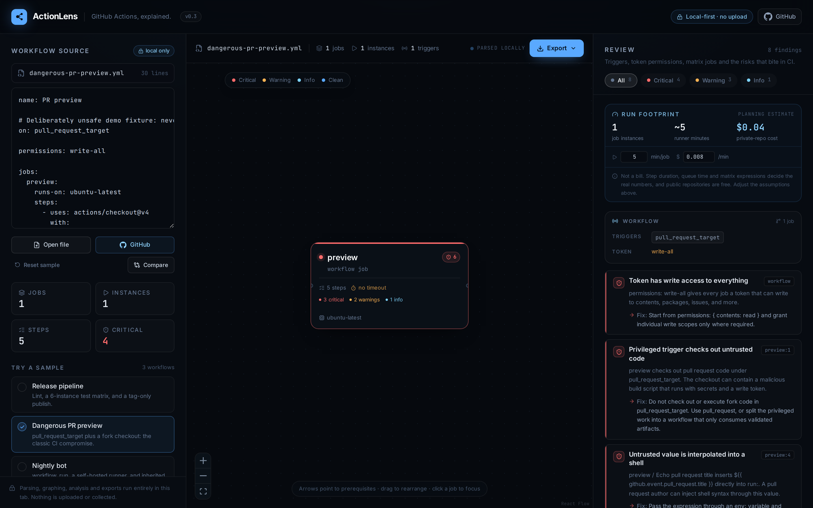
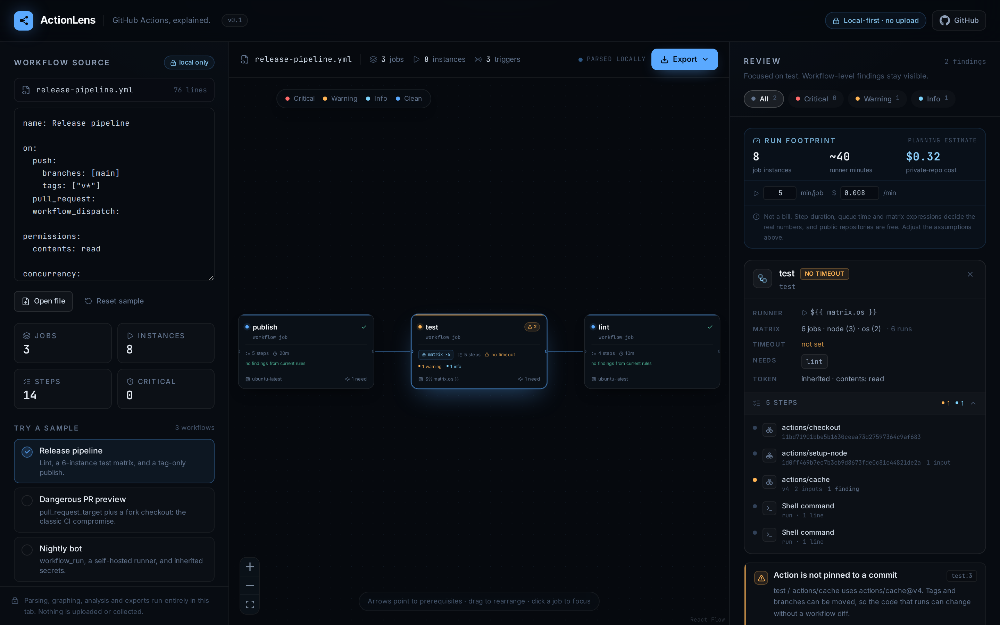

# ActionLens

**GitHub Actions, explained.** Paste a workflow and see the job graph, the real matrix size, the token permissions, the risky triggers, and a rough run footprint — before it reaches `main`.

[](https://github.com/hix-pro/action-lens/actions/workflows/ci.yml)
[](LICENSE)



> The screenshot uses the bundled **Dangerous PR preview** sample, which is intentionally unsafe. No real workflow, secret, or repository data is included.

## Why

A workflow file is deceptively small. `needs` hides the dependency order, `strategy.matrix` can turn three jobs into eighteen, `permissions` is often missing entirely, and a single `${{ github.event.pull_request.title }}` inside `run:` is enough to hand a pull request author a shell. ActionLens turns the YAML into a graph and a review so those details are visible at a glance.

Everything runs in the browser. There is no backend, no GitHub token, and no upload.

## Features

- **Job graph** — jobs, `needs` edges, matrix size, runner, timeout state, and severity at a glance.
- **16 review rules** — privileged triggers, token permissions, secret handling, script injection, unpinned actions, self-hosted runners, and more.
- **Real matrix arithmetic** — computes `matrix` dimensions with `include`/`exclude` rules and marks expression-driven matrices as dynamic instead of pretending to know.
- **Job inspector** — click a node for runner, matrix, timeout, needs, inherited token permissions, and a safe step list. Step scripts and secret values are never printed.
- **Run footprint** — a configurable planning estimate for job instances, runner minutes, and private-repo cost. It is not a bill.
- **Exports** — Mermaid, Markdown, SVG, PNG, and JSON. Findings are redacted; environment values and script bodies never leave the app in a report.
- **Local-only editing** — paste, drop, or open a file. Session and assumptions persist in `localStorage`; clear site data to remove them.
- **Bundled examples** — a release pipeline with a matrix, a deliberately dangerous PR preview, and a nightly deploy bot.



## Quick start

Requires **Node.js 20+**.

```bash
npm install
npm run dev
```

Open the printed local URL. The app starts with the **Dangerous PR preview** sample; choose another sample in the left panel or open your own workflow.

Production build:

```bash
npm run build
npm run preview
```

Quality checks:

```bash
npm run check    # tests, typecheck, production build
npm test         # 52 Vitest unit tests
npm run typecheck
```

A live demo is published at **<https://hix-pro.github.io/action-lens/>**.

## Using it

1. Paste a workflow into the editor, drag a `.yml`/`.yaml` file anywhere onto the page, or click **Open file**.
2. Read the graph. An arrow points from a job to a job it needs.
3. Click a job to inspect its runner, matrix, timeout, token, and steps.
4. Work through the review. Each finding includes a concrete fix.
5. Adjust the footprint assumptions or export a report for a pull request.

The editor remembers the last file and assumptions in `localStorage`. Use **Reset sample** to return to a known fixture.

## What it checks

| Severity | Rule | Why it matters |
| --- | --- | --- |
| Critical | `write-all` | A workflow or job token can write to every scope. |
| Critical | `hardcoded-secret` | Secret-looking values and live token patterns are committed in the workflow. Values are redacted from findings. |
| Critical | `missing-needs` | `needs` points at a job that does not exist, so the workflow cannot run. |
| Critical | `pr-target-untrusted-checkout` | `pull_request_target` checks out fork code, the classic path to a secrets-stealing build script. |
| Critical | `script-injection` | An untrusted `github.event`, `github.head_ref`, or `inputs` value is interpolated directly into `run:`. |
| Warning | `missing-trigger` | A workflow without `on:` never runs. |
| Warning | `pull-request-target` | The trigger runs with a privileged token and repository secrets. |
| Warning | `workflow-run-trigger` | `workflow_run` is privileged and consumes artifacts from another run. |
| Warning | `missing-permissions` | Jobs inherit the repository's default token permissions. |
| Warning | `unpinned-action` | A tag or branch can move; the code that runs can change without a workflow diff. |
| Warning | `unpinned-reusable-workflow` | The called workflow is referenced by a moving ref. |
| Warning | `secrets-inherit` | `secrets: inherit` hands every repository secret to another workflow. |
| Warning | `self-hosted-runner` | Self-hosted runners are risky for public repositories and untrusted jobs. |
| Warning | `remote-script` | A network download is piped directly into a shell. |
| Info | `missing-timeout` | A hung job can consume runner minutes until the platform limit. |
| Info | `secret-in-run` | A secret is interpolated into a shell command instead of an `env:` variable. |

Pinning is accepted for full 40-character commit SHAs, local `./` actions, and `docker://` references. `${{ ... }}` expressions are treated as references, not literals.

### Matrix expansion

The count follows GitHub's documented `include`/`exclude` behaviour:

```yaml
strategy:
  matrix:
    os: [ubuntu-latest, windows-latest]
    node: [20, 22, 24]
    exclude:
      - os: windows-latest
        node: 20
    include:
      - node: 22
        coverage: true
```

This expands to five job instances: six combinations minus one exclusion, with the `include` entry merged into an existing combination. Include entries that cannot merge add a job. Expression-driven matrices such as `${{ fromJSON(...) }}` are marked **dynamic** and counted as one or more, never as a made-up exact number.

### Run footprint

The footprint is a planning estimate, not a bill:

```text
job instances × assumed minutes per job × assumed price per minute
```

The defaults are **5 minutes/job** and **$0.008/minute** (a GitHub-hosted Linux runner rate for private repositories when this was written). Both are editable in the UI. Real durations vary by step, queue time, cache hit rate, and matrix expressions. **GitHub-hosted runners are free for public repositories**, so the dollar figure is only meaningful for paid usage.

## Exports

| Format | Best for |
| --- | --- |
| Mermaid | README diagrams and docs-as-code |
| Markdown | PR descriptions and review notes |
| SVG / PNG | Slides, issues, and architecture docs |
| JSON | Scripts and further analysis |

Reports include job configuration (ids, runners, matrix counts, needs, permission scopes, step names and keys) and findings. They deliberately exclude environment values and `run:` script bodies, so a report can be shared without copying a secret or an injection payload.

## Examples

The three files in [`examples/`](examples/) power the in-app samples:

- [`release-pipeline.yml`](examples/release-pipeline.yml) — lint, a 6-instance test matrix, and a tag-only publish with scoped permissions.
- [`dangerous-pr-preview.yml`](examples/dangerous-pr-preview.yml) — deliberately unsafe: `pull_request_target`, `write-all`, a fork checkout, script injection, and a literal token.
- [`nightly-bot.yml`](examples/nightly-bot.yml) — `workflow_run`, a self-hosted runner, a remote installer, and inherited secrets.

The dangerous file is the default demo. Do not deploy it.

```bash
# Drag any of these onto the app, or use Open file.
# GitHub can validate the workflow syntax with actionlint:
actionlint examples/release-pipeline.yml
```

## How it works

```text
workflow YAML
    │  src/lib/parse-workflow.ts   normalize triggers, permissions, jobs, steps, matrix
    ▼
Workflow
    │  src/lib/matrix.ts           include/exclude expansion and dynamic detection
    │  src/lib/analyze.ts          16-rule engine with severity + fix text
    ▼
Analysis ──────────────┐
    │                  │
    │  src/lib/layout.ts│  Dagre positions for React Flow
    ▼                  ▼
Job graph        Review panel
    │
    ├─ src/lib/estimate.ts         job instances and configurable footprint
    └─ src/lib/export.ts           Mermaid / Markdown / SVG / PNG / JSON
```

The parser accepts string/list/map triggers, schedule crons, shorthand/map permissions, workflow and job `env`, map or list `needs`, matrix `include`/`exclude`, reusable workflow jobs, `secrets: inherit`, and `timeout-minutes`. YAML is parsed with [`yaml`](https://eemeli.org/yaml/).

## Project layout

```text
src/
  components/       Header, source editor, graph, node card, inspector, review, export
  lib/
    parse-workflow.ts
    matrix.ts
    analyze.ts
    layout.ts
    estimate.ts
    export.ts
    samples.ts
    *.test.ts
  App.tsx
  index.css
  main.tsx
  types.ts
examples/           Real workflow fixtures used by the app
docs/               Screenshots used by this README
.github/workflows/  CI and GitHub Pages deploy
```

## Limitations

- **Static review only.** ActionLens does not run the workflow, resolve expressions, evaluate `if:` conditions, inspect action internals, or contact the GitHub API.
- **Not a security audit.** A clean review means these rules found nothing, not that the workflow is safe.
- **Dynamic matrices are unknowable.** Expressions, `fromJSON`, and reusable workflow outputs are marked dynamic rather than guessed.
- **The footprint is an estimate.** It uses a single minutes-per-job assumption; it does not model per-step duration, concurrent runners, cache hits, or billing rules.
- **Secret detection is heuristic.** It looks for secret-shaped keys and known token prefixes. A secret stored under an unrelated key or split across lines will be missed.
- **Reports contain configuration, not source.** `run:` bodies are reviewed in the browser but never included in an export.
- Tested in current Chromium. The app needs a modern browser with ES2022 support.

## Development

```bash
npm install
npm run dev          # Vite dev server
npm test             # 52 Vitest unit tests
npm run typecheck    # strict TypeScript, no emit
npm run build        # production build
npm run check        # all of the above
```

The parser, matrix calculator, rule engine, footprint estimator, and exporters are pure functions with unit tests; the UI only handles state and presentation.

## License

[MIT](LICENSE) © hix-pro

Fonts are self-hosted: [Inter](https://rsms.me/inter/) and [JetBrains Mono](https://www.jetbrains.com/lp/mono/) under the SIL Open Font License. See [THIRD_PARTY_NOTICES.md](THIRD_PARTY_NOTICES.md).
